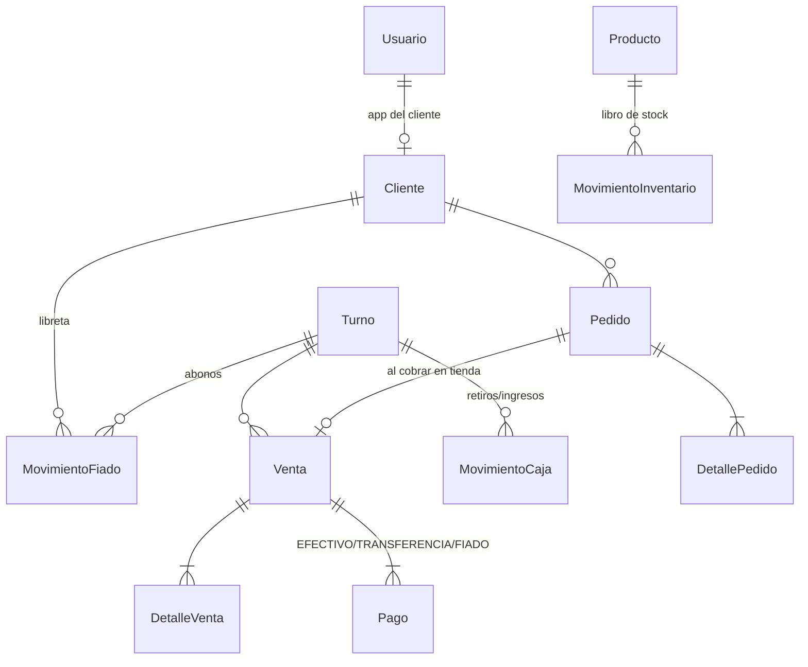

# Sistema de abarrotes — Backend (Django + DRF + Supabase)

API completa para: catálogo (con y sin código de barras), inventario con libro de movimientos, caja con
cuadre por método de pago, fiados (libreta digital) y pedidos anticipados con alarma.
**41 pruebas automáticas** (SQLite y PostgreSQL real).

## 1. Arquitectura y justificación

| Decisión | Por qué |
|---|---|
| **Django + Django REST Framework** | ORM con consultas siempre parametrizadas (sin SQL injection), migraciones, panel admin y permisos maduros. |
| **PostgreSQL (Supabase)** | Transacciones ACID, `CHECK`/`UNIQUE` condicionales, triggers y RLS. Todo el dinero va en `DECIMAL`, nunca `float`. |
| **API JSON + JWT** | Un solo backend sirve a la caja web, a la app de clientes (Android/Kotlin) y a futuras apps. Access token 10 min, refresh rotativo con lista negra. |
| **Capas por app** | `models` (reglas en la BD) → `services` (toda la lógica transaccional) → `views` (permisos + validación). Los servicios son la única vía para tocar stock, saldos y caja. |
| **Libros inmutables** | Stock, fiados, caja y auditoría son "solo agregar": las correcciones se hacen con un movimiento compensatorio. Así toda diferencia tiene explicación. |

Apps: `core` (base, auditoría, permisos, endurecimiento) · `usuarios` · `catalogo` · `inventario` · `clientes` (fiados) · `caja` · `ventas` · `pedidos`.

## 2. Modelo de datos



* **Producto**: una tabla con `tipo` = `CODIGO` | `GRANEL`. Un `CHECK` en la BD garantiza que *con código ⇒ código obligatorio y único* y *granel ⇒ sin código*. Unidad: UND/LB/KG/L/DOC. Imagen en Supabase Storage.
* **MovimientoInventario**: cantidad con signo + `stock_resultante`. Tipos: ENTRADA, SALIDA_VENTA, ANULACION_VENTA, AJUSTE, MERMA. `Producto.stock_actual` es un caché que solo cambia mediante estos movimientos.
* **Venta / DetalleVenta / Pago**: precio y nombre quedan "congelados" en el detalle. Pago mixto permitido (ej. parte efectivo, parte fiado). `idempotency_key` evita cobrar dos veces.
* **Turno**: fondo inicial, foto del cuadre al cerrar (esperado vs contado por método, diferencias). Un turno cerrado es inmutable.
* **Cliente + MovimientoFiado**: CARGO / ABONO / REVERSO con saldo resultante; límite de crédito opcional.
* **Pedido**: PENDIENTE → EN_PREPARACION → LISTO → ENTREGADO (solo cobrando) o CANCELADO. `alarma_pendiente` controla la alarma.

## 3. Decisiones donde el requerimiento era ambiguo

* **Stock negativo**: por defecto *no bloquea la venta* (el mostrador no se detiene por un inventario desactualizado); queda visible en alertas y se corrige con un ajuste. Cámbialo con `STOCK_NEGATIVO_PERMITIDO=0`.
* **Transferencias**: "confirmada al momento" = se exige n.º de comprobante. Así el cuadre de transferencias es verificable.
* **Cuadre**: esperado efectivo = fondo + ventas en efectivo + abonos en efectivo + ingresos − retiros; transferencias = ventas + abonos por transferencia. El fiado se informa aparte (no entra a caja). El cajero cuenta **a ciegas** (no ve el esperado hasta cerrar).
* **Anulaciones**: solo el admin y solo mientras el turno de esa venta siga abierto (el cuadre no se mueve entre turnos). Si el cliente ya abonó a esa deuda, se bloquea.
* **Pedidos**: no reservan stock; se cobra al **precio vigente al entregar** y el stock baja entonces. Máx. 3 pedidos activos por cliente.
* **Alarma**: la pantalla de caja consulta `GET /api/pedidos/alarma/` cada ~5 s y suena/parpadea mientras `hay_alarma` sea `true`; se apaga con `POST /api/pedidos/{id}/acusar/`.
* **Clientes sin app**: el personal los registra (fiado). Un cliente de la app que se registra con un teléfono ya existente **no** se vincula solo (evitaría que alguien reclame la deuda de otro); lo vincula el admin.

## 4. Seguridad (defensa en capas)

1. **SQL injection**: solo ORM/consultas parametrizadas, cero SQL crudo con datos del usuario; toda entrada pasa por serializers con tipos y límites (hay pruebas con payloads reales).
2. **Autenticación**: contraseñas con Argon2 (mín. 10 caracteres), JWT corto + refresh rotativo con lista negra, *rate limiting* (login 5/min, registro 5/h, pedidos 30/h). El rol del usuario nunca se acepta desde el cliente.
3. **Autorización**: cerrado por defecto (`IsAuthenticated`); roles ADMIN / CAJERO / CLIENTE; el cliente solo ve sus pedidos y su libreta (otro cliente recibe 404). El costo solo lo ve el admin.
4. **Datos que no se pierden**: sin `DELETE` en la API; FK con `PROTECT`; libros "solo agregar" (ORM **y** triggers en Postgres contra `UPDATE/DELETE/TRUNCATE`, probado con SQL directo); `CHECK` de dinero/cantidades; cada petición es una transacción; auditoría inmutable de ventas, anulaciones, ajustes, precios y cierres.
5. **Supabase**: tras cada `migrate` se activa **RLS en todas las tablas sin políticas** y se revoca todo a `anon`/`authenticated`: la API pública de Supabase (PostgREST) no puede leer nada; solo este backend accede a la BD. TLS obligatorio a la BD.
6. **Imágenes**: máx. 3 MB, solo JPG/PNG/WEBP verificados con Pillow, **re-codificadas a WEBP** (elimina EXIF y cargas ocultas), nombre UUID, bucket privado con URLs firmadas que caducan.
7. **HTTP**: HTTPS forzado + HSTS, cookies seguras, CORS con lista blanca, `X-Frame-Options: DENY`, admin en URL configurable. Sin `DJANGO_SECRET_KEY` o `DATABASE_URL` en producción, la app **se niega a arrancar**.

> Ningún sistema es "imposible de hackear"; esto cubre los vectores habituales. Lo que falta es operativo: activar **backups de Supabase** (plan Pro: diarios + PITR), usar 2FA en la cuenta de Supabase/hosting, rotar claves, y no exponer nunca la `service_role key`.

## 5. Puesta en marcha

```bash
python -m venv .venv && source .venv/bin/activate
pip install -r requirements.txt
cp .env.example .env        # completar con los datos de Supabase (ver comentarios)
export $(grep -v '^#' .env | xargs)
python manage.py migrate    # crea tablas + aplica RLS y triggers
python manage.py createsuperuser   # queda con rol ADMIN
python manage.py test       # 41 pruebas
gunicorn config.wsgi
```
Local sin Supabase: `DJANGO_DEBUG=1 python manage.py runserver` (usa SQLite). Crea cajeros desde el panel `/{ADMIN_URL}` (rol CAJERO).

**Supabase**: crear un bucket **privado** `productos`, generar las *S3 access keys* (Storage → S3 Connection) y copiar la cadena de conexión (Settings → Database).

## 6. API (resumen)

| Área | Endpoints |
|---|---|
| Auth | `POST /api/auth/login/ · refresh/ · logout/ · registro/` |
| Catálogo | `GET/POST /api/productos/` (`?q= ?tipo=CODIGO\|GRANEL ?stock_bajo=1`) · `GET /api/productos/por-codigo/{codigo}/` · `PATCH /api/productos/{id}/` (multipart para imagen) |
| Inventario | `GET /api/inventario/movimientos/` · `POST /api/inventario/entradas/` · `POST /api/inventario/ajustes/` · `GET /api/inventario/alertas/` |
| Caja | `POST /api/caja/turnos/abrir/` · `GET .../actual/` · `POST .../movimientos/` · `POST .../cerrar/` · `GET .../{id}/cuadre/` (admin) |
| Ventas | `POST /api/ventas/` · `GET /api/ventas/` · `POST /api/ventas/{id}/anular/` (admin) |
| Fiados | `GET /api/clientes/deudores/` · `GET /api/clientes/{id}/libreta/` · `POST /api/clientes/{id}/abono/` · `GET /api/mi-cuenta/` (cliente) |
| Pedidos | `POST /api/pedidos/` (cliente) · `GET /api/pedidos/alarma/` · `POST .../{id}/acusar/ · estado/ · entregar/ · cancelar/` |

Cobro típico (`POST /api/ventas/`):
```json
{"idempotency_key": "<uuid generado en la caja>",
 "items": [{"producto": "<id>", "cantidad": "2"}, {"producto": "<id>", "cantidad": "1.5"}],
 "pagos": [{"metodo": "EFECTIVO", "monto": "2.00"}, {"metodo": "FIADO", "monto": "1.20"}],
 "cliente": "<id, obligatorio si hay FIADO>", "efectivo_recibido": "5.00"}
```
